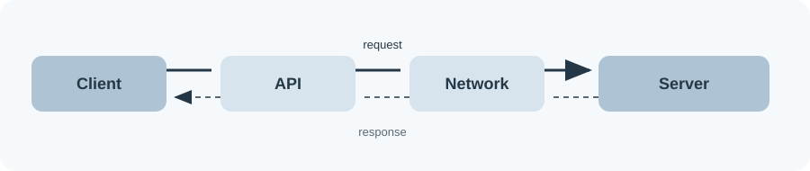
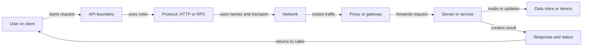
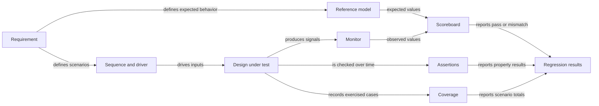
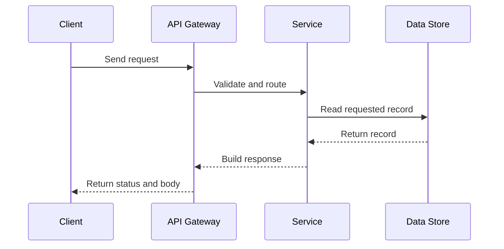
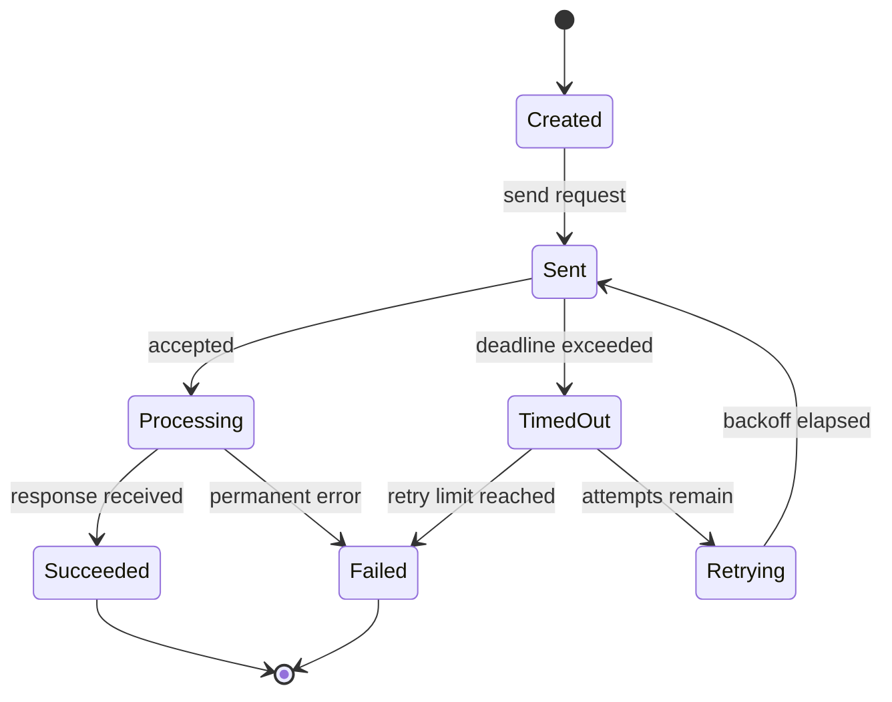

# Concept Maps

**Navigation:** [Home](../../README.md) | [Topic Index](../index.md) | [Roadmap](../learning-roadmap.md)

## Software Request Path

This path shows how a caller's request crosses an interface and protocol, may pass through an intermediary, and reaches a service that returns a result.

## From Code to Execution

```mermaid
flowchart LR
  Src[Source code] -->|translates or interprets| Front[Compiler or interpreter]
  Front -->|emits| Obj[Object code or bytecode]
  Obj -->|links or loads| Link[Linker or runtime loader]
  Link -->|starts| Run[Process and threads]
  Run -->|requests services from| OS[Operating system]
  OS -->|manages access to| HW[CPU, memory, and devices]
```

This is a simplified route from source text to a running program. Interpreters and runtimes can combine or repeat stages, so not every language creates the same intermediate files.

## Verification Loop

Requirements guide both the scenarios and expected behavior. The monitor observes the design, the scoreboard compares actual and expected values, assertions check properties, and coverage records what was exercised.

## API Request Sequence

The sequence makes the order explicit: the client waits for the gateway, service, and data store to finish their part before it receives the response.

## Request Retry States

The request succeeds, fails, or times out. A timeout can enter a bounded retry path; only retry operations that are safe to repeat, or protect them with idempotency or deduplication.

These diagrams are simplified: real systems may use several protocols, components, tool stages, clocks, and verification mechanisms. They are orientation aids, not implementation diagrams.
