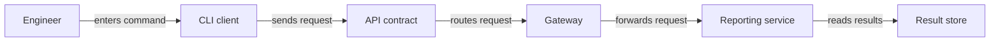

# Software Architecture and Interfaces

**Navigation:** [Home](../../../README.md) | [Topic Index](../../index.md) | [Roadmap](../../learning-roadmap.md)

Software architecture describes the major parts of a system and the ways they interact. Think of a system as a workshop: tools have jobs, shared rules let people hand work off, and the arrangement affects how easily the workshop can change.

## People, Boundaries, and Reusable Parts

| Term | Meaning and use |
|---|---|
| **Client** | A program or component that requests data or work from another component. A browser is a client when it requests a page. |
| **Server** | A program or component that accepts requests and returns data or performs work. These are roles for a particular interaction; one program can take both roles. |
| **API** | Application Programming Interface: the operations and rules a software component exposes to callers. A test tool may ask a service API for a run result. See [API/ABI/SDK](../../comparisons/interfaces-and-communication.md#api-abi-and-sdk). |
| **ABI** | Application Binary Interface: low-level rules that let separately compiled pieces work together, such as calling conventions, symbol names, and data layout. |
| **SDK** | Software Development Kit: APIs plus tools, libraries, examples, and documentation for building against a platform or service. |
| **CLI / GUI** | Command-Line Interface accepts typed commands and arguments; Graphical User Interface presents controls such as windows and buttons. Both are user interfaces. |
| **Interface / contract** | An interface is an agreed boundary for interaction; a contract states the expected inputs, outputs, and behavior. The word *interface* also has hardware and language-specific meanings. |
| **Abstraction / implementation** | An abstraction presents the useful idea while hiding details; an implementation is the concrete code or hardware that realizes it. |
| **Module / component** | A module is a named unit of organization, often within one program or package. A component is a replaceable part with defined responsibilities and boundaries. |
| **Library / framework** | A library supplies reusable functions that your code calls. A framework supplies structure and often calls your code at defined extension points. |
| **Package / dependency** | A package is a distributable unit of code or metadata. A dependency is something a component needs, such as another package, service, or tool. |
| **Plugin / extension** | An optional add-on loaded by a host to provide extra behavior. The exact term depends on the host ecosystem. |
| **Runtime / daemon / service** | A runtime provides the environment that executes a program. A daemon is a background process; a service is a broader function made available to other programs or users. |
| **Microservice / monolith** | A microservice is a separately operated service organized around a limited responsibility. A monolith is an application built and deployed as one unit. Either design can be appropriate; size alone is not the deciding factor. |
| **Callback / hook** | A callback is a function supplied to run after an event or operation. A hook is an exposed extension point where custom behavior can be attached. |
| **Coupling / cohesion** | Coupling describes how strongly parts depend on one another; cohesion describes how closely a part's responsibilities belong together. Designs often aim for manageable coupling and focused cohesion. |
| **Design pattern / architecture** | A design pattern is a reusable approach to a recurring design problem. Architecture is the higher-level structure and important decisions of a system. |
| **Integration** | Connecting components so they exchange data or work together. An interface contract helps reduce surprises at the boundary. |

## Intermediaries and Adaptation

| Term | Meaning and use |
|---|---|
| **Middleware** | Software in a request or data path that applies shared behavior, such as logging or authorization. It is a role, not a specific product. |
| **Adapter / wrapper / facade** | An adapter translates one interface into another; a wrapper encloses an object or function to add or change access; a facade offers a simpler front to a more complex subsystem. |
| **Proxy** | An intermediary that sends requests on behalf of another party. A forward proxy is commonly configured by clients; a reverse proxy fronts servers. |
| **Gateway / API gateway** | A gateway connects systems or networks and may translate protocols. An API gateway commonly centralizes API routing and related policies such as authentication or rate limits. |
| **Bridge** | A component that connects two systems or domains, often translating between their interfaces or representations. In hardware, *bridge* may name a protocol or bus interconnect component. |
| **Broker / agent / orchestrator** | A broker mediates messages or service access. An agent is a context-dependent participant that performs work for a framework or system. An orchestrator coordinates multiple components or tasks. |

### Example: a report request

An engineer's command-line client calls a test-results API. An API gateway checks the request and routes it to a reporting service. The service reads stored results and returns a response. The API is the agreed boundary; the gateway and service are implementations behind it.

The engineer's command becomes an API request. The gateway routes it to the reporting service, which reads the result store before returning data.

**Common confusion:** API, protocol, and ABI describe different kinds of agreements. An API is a callable or message-level interface; a protocol specifies communication rules; an ABI supports binary-level compatibility. See [API vs protocol](../../comparisons/interfaces-and-communication.md#api-and-protocol) and the [programming page](../programming-and-compilation/programming-and-execution.md).

**References:** [RFC 9110, HTTP semantics and client/server roles](https://www.rfc-editor.org/rfc/rfc9110.html); [Pro Git](https://git-scm.com/book/en/v2) for repository and component examples.
