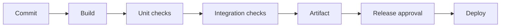

# Git and DevOps

**Navigation:** [Home](../../../README.md) | [Topic Index](../../index.md) | [Roadmap](../../learning-roadmap.md)

Git records changes to files so people can compare, restore, and combine work. GitHub is one hosted collaboration service that can store Git repositories and add reviews, issues, and automation.

## Git Vocabulary

| Term | Meaning and use |
|---|---|
| **Git / repository** | Git is a distributed version control system. A repository stores project content and its version history. |
| **Working tree / staging area / commit** | The working tree is the checked-out files. The staging area selects content for the next snapshot. A commit records a snapshot and metadata. |
| **Branch / merge / rebase / cherry-pick** | A branch is a movable name for a line of history. A merge joins histories. A rebase reapplies commits onto another base. Cherry-pick applies selected commit changes elsewhere. Rebase rewrites commit identities; use care with shared history. |
| **Tag** | A named reference commonly used to mark a release or other important commit. |
| **Remote / clone / fetch / pull / push** | A remote names another repository. Clone creates a local copy. Fetch retrieves updates without integrating them. Pull fetches and integrates according to configuration. Push sends local refs and objects to a remote. |
| **Pull request / code review / merge conflict** | A pull request proposes changes for discussion and integration on a hosting platform. Code review examines a change. A merge conflict means Git cannot automatically combine edits that overlap or interact. |
| **`.gitignore` / GitHub** | `.gitignore` patterns tell Git which untracked files to ignore; it does not remove already tracked files. GitHub is a hosting and collaboration platform, not Git itself. |

## CI/CD and Release Terms

| Term | Meaning and use |
|---|---|
| **CI / continuous integration** | Continuous Integration (CI) frequently integrates changes and runs checks to detect problems early. |
| **CD / continuous delivery / continuous deployment** | Continuous Delivery (CD) keeps changes in a releasable state, with release commonly gated by a human. Continuous Deployment (also abbreviated CD) automatically releases qualifying changes to production. Expand *CD* because it can mean either practice. |
| **Pipeline / stage / job / workflow / runner** | A pipeline is a sequence of automated work. A stage groups work; a job is a unit scheduled for execution; a workflow defines automation and triggers; a runner executes jobs. Terms vary among platforms. |
| **Build artifact / release / versioning / semantic versioning** | A build artifact is an output such as a package or binary. A release makes a version available. Versioning labels revisions; Semantic Versioning gives a convention for communicating compatibility through major, minor, and patch numbers. |
| **Container / container image / registry** | A container is an isolated process environment. An image is a packaged template used to start containers. A registry stores and distributes images. Container isolation shares the host kernel in common implementations. |
| **Virtual machine / infrastructure as code (IaC)** | A virtual machine emulates a computer platform and can run its own guest operating system. Infrastructure as Code (IaC) describes infrastructure in machine-readable files that tools can apply. |
| **Deployment / rollback / environment** | Deployment makes a version available in a target environment. Rollback returns to a previous version or configuration. Development, staging, and production are common environments with different purposes and controls. |
| **Canary release** | A release strategy exposes a new version to a limited share of traffic or users before wider rollout, so behavior can be observed and risk contained. |

### Illustrative CI pipeline

**Common confusion:** CI is not the same as deployment. A pipeline may build and test without publishing anything. See [delivery comparisons](../../comparisons/delivery-and-reliability.md).

A CI pipeline may schedule a **unit test**, **integration test**, **system test**, **end-to-end test**, **regression test**, or **smoke test** depending on its stage and purpose. These labels describe different scopes or goals and can overlap; see [test levels and purposes](../testing-and-debugging/testing-debugging-and-reliability.md#test-levels-and-purposes).

**References:** [Pro Git](https://git-scm.com/book/en/v2); [Git branch documentation](https://git-scm.com/docs/git-branch); [GitHub Docs: CI](https://docs.github.com/en/actions/get-started/continuous-integration); [GitHub Docs: Workflows](https://docs.github.com/en/actions/concepts/workflows-and-actions/workflows).
